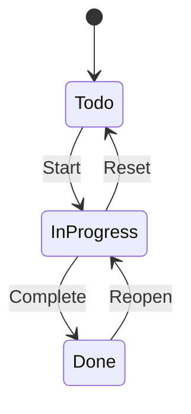

# Task Tracker

## О проекте

Учебный проект для практики Clean Architecture, EF Core и тестирования.
Управление задачами с переходами статусов: Todo → InProgress → Done.
Backend и Frontend MVP завершены.

## Жизненный цикл задачи

Задача проходит через три статуса:

- **Todo** — «надо сделать».
- **InProgress** — «делаю сейчас».
- **Done** — «сделано».



Переходы:

- **Start** — начать работу.
- **Complete** — завершить.
- **Reset** — отложить, вернуться позже.
- **Reopen** — возобновить работу.

Endpoint `Reset` вызывает доменный метод `ReturnToTodo()` — это один и тот же переход `InProgress → Todo`.

Детали переходов, инварианты и идемпотентность Complete на Done — в `docs/DOMAIN.md`.

## Стек

| Область | Технология |
|---|---|
| Язык / платформа | C# / .NET 10 |
| Web | ASP.NET Core Web API (Controllers) |
| БД / ORM | Entity Framework Core + MSSQL |
| Валидация | FluentValidation |
| Тесты | xUnit + NSubstitute |
| API-документация | OpenAPI / Swagger UI |
| Frontend | Vue 3 + TypeScript + Vite + Pinia + Naive UI |

## Структура репозитория

```text
TaskTracker/
├── AGENTS.md          — правила работы агента
├── docs/              — проектная документация
├── scripts/           — verify.sh, verify.ps1
├── src/
│   ├── Backend/
│   │   └── PS.TaskTracker/   — solution backend'а
│   └── Frontend/
│       └── PS.TaskTracker/   — frontend на Vue 3
└── tests/
    └── Backend/       — тесты: Domain.Tests, Application.Tests
```

## Документация

| Файл | Что описывает |
|---|---|
| [AGENTS.md](AGENTS.md) | Правила работы агента |
| [docs/PROJECT.md](docs/PROJECT.md) | Карта проекта |
| [docs/SPEC.md](docs/SPEC.md) | Требования MVP и API-контракты |
| [docs/DOMAIN.md](docs/DOMAIN.md) | Доменная модель |
| [docs/ARCHITECTURE.md](docs/ARCHITECTURE.md) | Слои и зависимости |
| [docs/DECISIONS.md](docs/DECISIONS.md) | Журнал архитектурных решений |
| [docs/FRONTEND.md](docs/FRONTEND.md) | Стек и структура frontend |
| [docs/ROADMAP.md](docs/ROADMAP.md) | План разработки |

## Текущий статус

Backend и Frontend MVP завершены (Этапы 0–7). Все 44 теста зелёные, сценарии API и UI проверены. Детали — в [docs/ROADMAP.md](docs/ROADMAP.md).

## Запуск

### Требования

- **.NET 10 SDK** — именно SDK, не только Runtime. Версия `10.0.4XX` или новее в линии 10.0. Проверить: `dotnet --list-sdks`.
- **Node.js 22.18–22.x или 24.12+** (рекомендуется 24 LTS) и npm.
- **SQL Server** (Developer или Express), локальный инстанс.
- **dotnet-ef** — глобальный инструмент: `dotnet tool install --global dotnet-ef`.

### Шаги

1. Настроить строку подключения в `src/Backend/PS.TaskTracker/PS.TaskTracker.API/appsettings.Development.json`:

   ```json
   "ConnectionStrings": {
     "Default": "Server=localhost;Database=TaskTracker;Trusted_Connection=True;TrustServerCertificate=True;"
   }
   ```

2. Применить миграции:

   ```text
   dotnet ef database update --project src/Backend/PS.TaskTracker/PS.TaskTracker.Infrastructure --startup-project src/Backend/PS.TaskTracker/PS.TaskTracker.Infrastructure
   ```

3. Запустить API:

   ```text
   dotnet run --project src/Backend/PS.TaskTracker/PS.TaskTracker.API
   ```

4. Открыть Swagger UI: `https://localhost:7190/swagger` (или порт из launchSettings.json).

### Тесты

```text
dotnet test
```

Или через скрипт:

- Windows: `.\scripts\verify.ps1`
- Linux / macOS: `./scripts/verify.sh`

## Frontend

Frontend — отдельное приложение на Vue 3.

### Запуск

1. Установить зависимости:

   ```text
   cd src/Frontend/PS.TaskTracker
   npm install
   ```

2. Запустить dev-сервер:

   ```text
   npm run dev
   ```

3. Открыть: http://localhost:5173

Backend должен быть запущен на `http://localhost:5029` (см. `.env.development`).

Детали — в `docs/FRONTEND.md`.
