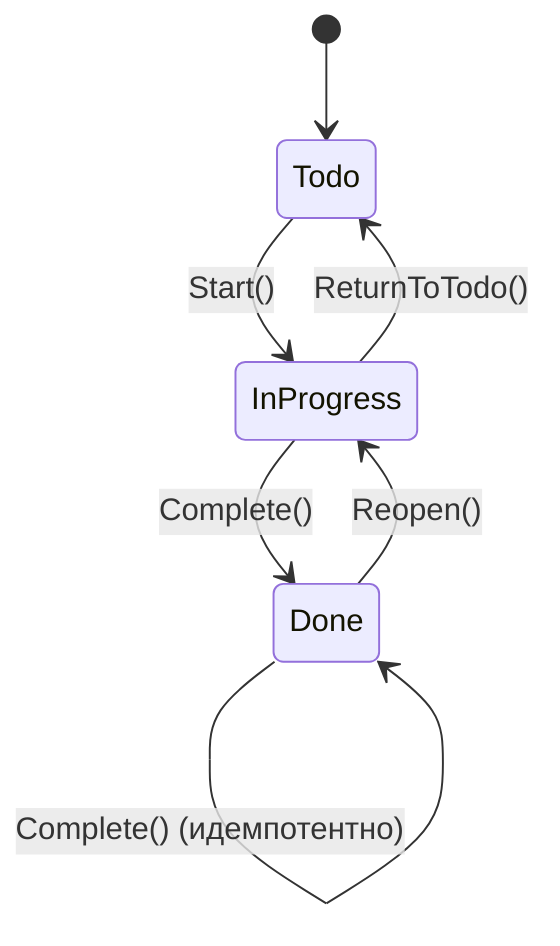

# DOMAIN — доменная модель

## 1. Назначение документа

DOMAIN описывает ядро системы: сущность `TaskItem`, инварианты, переходы статусов и ошибки домена — независимо от хранения, API и транспорта.
HTTP-контракты и DTO — в `docs/SPEC.md`; слои, DI и EF Core — в `docs/ARCHITECTURE.md`; здесь их нет.

## 2. Сущность TaskItem

| Поле | Тип | Доступ | Описание |
|---|---|---|---|
| `Id` | `Guid` | get, private set | Идентификатор, назначается при создании |
| `Title` | `string` | get, private set | Заголовок, обязателен |
| `Description` | `string?` | get, private set | Описание, опционально |
| `Status` | `TaskItemStatus` | get, private set | Текущий статус |
| `CreatedAtUtc` | `DateTime` | get, private set | Момент создания, UTC |
| `UpdatedAtUtc` | `DateTime` | get, private set | Момент последнего изменения, UTC |

Все сеттеры приватные. Изменить состояние задачи снаружи можно только через методы (`Create`, `Start`, `Complete`, `Reopen`, `ReturnToTodo`, `UpdateDetails`) — это защищает инварианты от обхода проверок.

## 3. Создание задачи

Публичного конструктора нет. Единственный публичный способ создать задачу — фабричный метод `Create(title, description, utcNow)`.

Фабричный метод, а не публичный конструктор, потому что:

- создание — это не просто выделение памяти, а акт с проверкой инвариантов (`Title` обязателен, длины в допустимых пределах);
- конструктор нельзя «доделать» после вызова — фабрика возвращает либо валидный объект, либо исключение;
- приватный основной конструктор + `private TaskItem()` (только для EF Core) не дают создать объект в обход правил.

`utcNow` передаётся параметром, а не берётся из `DateTime.UtcNow` внутри домена: домен не зависит от системных часов, время детерминировано — это делает юнит-тесты простыми и воспроизводимыми (никаких подмен часов).

При создании:

- `Id` генерируется (новый `Guid`) и не передаётся извне;
- `Status` всегда `Todo`;
- `CreatedAtUtc` и `UpdatedAtUtc` равны переданному `utcNow`.

Псевдокод:

```
Create(title, description, utcNow):
    validate(title, description)        // инварианты, нарушение → DomainValidationException
    task.id = new Guid()
    task.title = title
    task.description = description
    task.status = Todo
    task.createdAtUtc = utcNow
    task.updatedAtUtc = utcNow
    return task
```

## 4. Статусы

Enum `TaskItemStatus`, живёт в Domain:

| Значение | Смысл |
|---|---|
| `Todo` | Задача поставлена, ещё не начата. Начальный статус при создании. |
| `InProgress` | Задача в работе. |
| `Done` | Задача завершена. |

Начальный статус при создании — `Todo`.

## 5. Переходы статусов



| Метод | Исходный статус | Результирующий | При недопустимом вызове |
|---|---|---|---|
| `Start()` | `Todo` | `InProgress` | `DomainConflictException` |
| `Complete()` | `InProgress` | `Done` | `DomainConflictException` |
| `Complete()` | `Done` | `Done` (без изменений) | без исключения |
| `Reopen()` | `Done` | `InProgress` | `DomainConflictException` |
| `ReturnToTodo()` | `InProgress` | `Todo` | `DomainConflictException` |

При успешном переходе `UpdatedAtUtc` обновляется на переданное время (`utcNow` параметром).

### Идемпотентность Complete() на Done

`Complete()` на задаче в статусе `Done` не бросает исключение: повторный вызов — это не ошибка, а повтор того же действия (например, двойной клик клиента или повтор запроса после таймаута). `UpdatedAtUtc` в этом случае не меняется — задача не изменилась, и штамп времени должен это отражать; молчаливое «обновление времени» исказило бы историю.

### Запрет Todo → Done

Прямой переход `Todo → Done` невозможен: завершение допустимо только из `InProgress`. Это отражает жизненный цикл — задачу нельзя завершить, пока она не начата. Обойти правило можно только недокументированным мутатором, а все сеттеры приватные, поэтому обхода нет.

## 6. Инварианты

| Инвариант | Где проверяется | При нарушении |
|---|---|---|
| `Title` — не null, не пустой, не whitespace | Domain (`Create`, `UpdateDetails`) | `DomainValidationException` |
| `Title` ≤ 200 символов | Domain (`Create`, `UpdateDetails`) | `DomainValidationException` |
| `Description` — если не null, ≤ 2000 символов | Domain (`Create`, `UpdateDetails`) | `DomainValidationException` |
| `CreatedAtUtc` ≤ `UpdatedAtUtc` | Domain (следствие операций, не проверяется отдельным if) | невозможно по построению |
| Начальный статус — `Todo` | Domain (`Create`) | невозможно по построению |

Domain не доверяет Application: двойная валидация — не дублирование, а разные цели. Domain — последняя линия обороны, он гарантирует инварианты всегда, из любого вызывающего кода. FluentValidation в Application проверяет те же правила на входных DTO, чтобы вернуть дружелюбные сообщения в `400`, но даже если Application пропустит невалидные данные, Domain их отклонит.

## 7. Ошибки домена

В Domain три типа исключений, все живут в `PS.TaskTracker.Domain.Exceptions`:

| Исключение | Когда | HTTP-статус (маппит Middleware) |
|---|---|---|
| `DomainException` | Базовое. Напрямую не бросается. | — |
| `DomainValidationException : DomainException` | Нарушение инвариантов (`Title`, `Description`). | `400` |
| `DomainConflictException : DomainException` | Недопустимый переход статуса. | `409` |

`DomainException` — базовый тип, чтобы Middleware мог поймать все доменные ошибки одним catch, а затем различить по конкретному типу. Напрямую `DomainException` не бросается: всегда используется один из двух наследников.

Сообщения — английские (для логов и клиента), краткие, с точкой в конце. Примеры:

`DomainConflictException`:

- `Cannot start task in status Done.`
- `Cannot complete task in status {Status}.` — где `{Status}` — текущий статус задачи.
- `Cannot reopen task in status Todo.`
- `Cannot return task to todo in status Done.`

`DomainValidationException`:

- `Title must not be empty.`
- `Title must not exceed 200 characters.`
- `Description must not exceed 2000 characters.`

В API-слое Middleware маппит исключения в HTTP-статусы по типу (см. таблицу выше). Детали маппинга — в `docs/ARCHITECTURE.md`.

## 8. Метод UpdateDetails

Сигнатура: `UpdateDetails(title, description, utcNow)`.

Что делает:

- валидирует `Title` и `Description` по тем же инвариантам, что и `Create` (при нарушении бросается `DomainValidationException`);
- обновляет `Title`, `Description`;
- обновляет `UpdatedAtUtc` на переданное `utcNow`.

Что не делает:

- не трогает `Status` — статус меняется только методами переходов;
- не трогает `CreatedAtUtc`.

## 9. Что НЕ входит в Domain

Domain ничего не знает про инфраструктуру и транспорт. В `PS.TaskTracker.Domain` нет:

- EF Core (DbContext, атрибуты `[Key]`, `[Required]`, конфигурации);
- репозиториев и их интерфейсов;
- `DateTime.UtcNow` — время приходит параметром;
- `ILogger`, `IClock` и прочих сервисов;
- атрибутов валидации ASP.NET Core;
- `JsonConverter`, JSON-атрибутов;
- DTO.

## 10. Открытые вопросы

Вне MVP, осознанно не решено:

- Конкурентный доступ (оптимистичные блокировки) — одна задача может изменяться из двух запросов параллельно.
- Мягкое удаление — сейчас удаление физическое.
- История изменений — `UpdatedAtUtc` хранит только последнее изменение, не хронологию.
